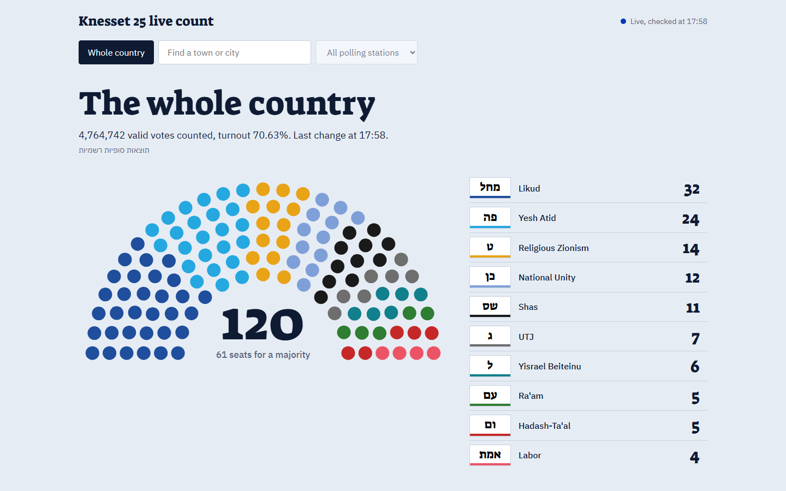

# Knesset live count

Follow the Israeli Knesset election count as it happens. This tool watches the Central Elections
Committee results site, works out the seat allocation that the site itself doesn't show while votes are being
counted, and turns it into a Wikipedia-style seat diagram plus text you can paste straight into Discord.

Run it on your own computer, or host it as a website for your Discord server.

The site was built with AI (Claude, by Anthropic) and says so in its footer: it may contain mistakes, so check
anything that matters against the Central Elections Committee's official results.



## Features

- **Seats from the live count.** The 3.25% threshold, the Bader-Ofer method and surplus agreements, as set out in
  the Knesset Elections Law. Run on the 2022 results, it reproduces the official 32 / 24 / 14 / 12 / 11 / 7 / 6 / 5 / 5 / 4.
- **Past elections and the night so far.** Pick any election back to April 2019 (shown with the official final seats),
  or slide back through election night: every new result is saved, so you can see how the count developed, for the
  whole country and for towns and polling stations (see [Looking back through the night](#looking-back-through-the-night)).
- **Blocs.** Lists are grouped into blocs (for 2026: outgoing coalition, alternative government bloc, Arab parties,
  other lists), with bloc seat totals against the 61-seat line on the page, in the Discord text and in the image.
- **Election night.** A projection of where the count is heading, with a likely range for every list and bloc and the
  chance of each list near the threshold passing it, how many votes are still out, how close every list is to its next
  seat (and to the threshold) and which candidate that seat would bring in or cost, what each surplus agreement did, a
  coalition builder, and the TV exit polls next to the count. Hover a seat in the diagram to see who sits in it.
- **A statistics page.** Strongest and weakest towns and polling stations for any bloc or list, a map of every town,
  results by kind of place (kind of town, population, district and socio-economic cluster), the Knesset each kind of
  place would elect, how spread out each list's support is, which lists rise and fall together (with the scatter
  chart behind any pair), the towns that voted most like any place, how split the vote is, "islands", the small parties'
  corner, results that stand out, where each list's votes come from, and turnout.
- **A trends tab.** Every election since April 2019 side by side: blocs over time, each party's share followed through
  mergers and renames, turnout and votes lost below the threshold (by bloc), the towns with the biggest swings (with a
  map and each town's history), volatility and estimated vote flows between two elections, how the exit polls did, and
  how the parties connect, through joint lists, surplus agreements and the towns they share.
- **The whole country, a town, or one polling station.** For a town or polling station, the seats show the Knesset
  *as if the whole country had voted like that place*.
- **Every list counts.** Small parties are never lumped into "others". All lists are ranked with the threshold line
  running through them, and each one appears in the shared image and text with its percentage and raw vote count.
- **One-click Discord sharing.** Copy the seat diagram and paste it with Ctrl+V, drag it into the chat, or download
  the PNG. Copy the text with one button; if it's longer than Discord's 2,000-character limit it splits into
  numbered parts.
- **Your own labels.** Anyone can rename and recolor lists and reorder the seat diagram. Visitors' changes stay in
  their own browser; the admin's changes become everyone's defaults.
- **Light on the elections site.** One page load per minute, however many people are watching (see
  [How it works](#how-it-works)).

## Run it on your computer

You need Python 3.9 or later.

```
pip install -r requirements.txt
```

- **Windows:** double-click `start.bat`.
- **Other systems:** run `python app.py`.

Your browser opens at <http://localhost:8026>. Closing the console window stops it. On your own computer you're
automatically the admin, so you can change everything.

**Try it before election day:** pick a past election, such as Knesset 25 (November 2022), from the election menu.

## Host it as a website

Host it on a small server, preferably in an Israeli region: a server in Stockholm could read the elections site
in October 2026, but the site could limit access to Israeli addresses on election night. Any of these is free or close
to it for election week:

| Host | Region | Cost |
|---|---|---|
| Oracle Cloud "Always Free" VM | Jerusalem (choose it as your home region at sign-up) | Free |
| AWS EC2 `t4g.nano` or `t3.micro` | Tel Aviv (`il-central-1`) | About $2 for a week, or free with new-account credits |
| Google Cloud `e2-micro` | Tel Aviv (`me-west1`) | About $2 for a week, or free with new-account credits |

The steps below use an Ubuntu server and a free Cloudflare quick tunnel, which gives the site an `https://` address
without buying a domain or opening any firewall ports. HTTPS matters: browsers only allow **Copy image** on secure
pages.

1. **Create an Ubuntu VM** in one of the regions above, and connect to it with SSH.

2. **Check that the elections site answers this server:**

   ```bash
   curl -s -A "Mozilla/5.0 (Windows NT 10.0; Win64; x64) AppleWebKit/537.36 (KHTML, like Gecko) Chrome/130.0 Safari/537.36" \
     https://votes25.bechirot.gov.il/nationalresults | grep -c ResultsSummaryTable
   ```

   `1` means the site answers this server. `0`, or a connection error, means it's blocked: try another provider or
   region. (The full browser user-agent matters: with a short one the site returns an error page.)

3. **Copy the app over.** From the project folder on your own computer:

   ```bash
   ssh ubuntu@SERVER mkdir -p knesset
   scp app.py index.html config.json ubuntu@SERVER:knesset/
   ```

4. **Install and start it** on the server. Pick a long random admin token. This command prints one:
   `python3 -c "import secrets; print(secrets.token_urlsafe(16))"`

   ```bash
   sudo apt update && sudo apt install -y python3-requests
   echo "ADMIN_TOKEN=paste-your-token-here" | sudo tee /etc/knesset.env > /dev/null && sudo chmod 600 /etc/knesset.env
   sudo tee /etc/systemd/system/knesset.service > /dev/null <<'EOF'
   [Unit]
   Description=Knesset live count
   After=network-online.target

   [Service]
   User=ubuntu
   WorkingDirectory=/home/ubuntu/knesset
   EnvironmentFile=/etc/knesset.env
   Environment=PYTHONUNBUFFERED=1
   ExecStart=/usr/bin/python3 app.py
   Restart=always

   [Install]
   WantedBy=multi-user.target
   EOF
   sudo systemctl enable --now knesset
   ```

5. **Give it a public HTTPS address** with a Cloudflare quick tunnel (no Cloudflare account needed):

   ```bash
   curl -L -o cloudflared.deb https://github.com/cloudflare/cloudflared/releases/latest/download/cloudflared-linux-$(dpkg --print-architecture).deb
   sudo dpkg -i cloudflared.deb
   sudo tee /etc/systemd/system/knesset-tunnel.service > /dev/null <<'EOF'
   [Unit]
   Description=Public address for the Knesset live count
   After=knesset.service

   [Service]
   ExecStart=/usr/bin/cloudflared tunnel --no-autoupdate --url http://localhost:8026
   Restart=always

   [Install]
   WantedBy=multi-user.target
   EOF
   sudo systemctl enable --now knesset-tunnel
   sleep 10; journalctl -u knesset-tunnel | grep -o 'https://[a-z0-9-]*\.trycloudflare\.com' | tail -1
   ```

   The last command prints your site's address. Share it with your friends.

6. **Make yourself admin:** open `https://YOUR-ADDRESS/?admin=YOUR-TOKEN` once. Your browser remembers the token
   and removes it from the address bar. Don't share that link. If you lose the token, `sudo cat /etc/knesset.env`
   on the server shows it.

**Updating:** copy the changed code over with `scp app.py index.html ubuntu@SERVER:knesset/`, then run
`sudo systemctl restart knesset`. Don't copy `config.json` again: the server's copy holds the changes you made as admin
on the site. The tunnel address only
changes if the tunnel itself restarts (for example after a server reboot), so run the `journalctl` command again in
that case. For an address that never changes, use your own domain with a named Cloudflare tunnel or Caddy.

**Privacy:** nothing on the site names you. The tunnel address is random words, visitors never see the server's own
IP address, and your hosting account isn't visible to anyone.

## Using it

### Choosing what to show

| Control | Shows |
|---|---|
| **Election** menu | The election followed live (the default), or the final results of Knesset 21–25 (2019–2022) |
| **Whole country** | National results |
| **Town** search box | Type part of a name, in Hebrew or English ("bnei brak" finds בני ברק), and pick it with the mouse or the arrow keys and Enter. Before you type, it lists the largest towns |
| **Polling station** menu | Becomes available once a town is chosen. Lists every ballot box with its location |

The page updates itself when new results arrive.

### Looking back through the night

Once the live election has more than one saved update for what you're viewing, a slider appears under the headline.
Drag it to see the results as they stood at any earlier update, with the time and update number underneath; the shared image and text
say "as of" that time. **Back to the latest** returns to the live results. New results keep arriving while you look
back, and the slider grows without moving you.

Where a town's or polling station's timeline comes from depends on the admin's spreadsheet setting:

- **Spreadsheet check on:** the committee may publish a spreadsheet of every polling station's results
  (`media26.bechirot.gov.il/files/expb.csv`) during the count. If it does, every saved version gives every town and
  polling station a point on its timeline. The cost is one request per check, and an unchanged file costs almost
  nothing because the server answers "not modified". Its numbers match the site's own pages exactly (checked on the 2022
  results).
- **Spreadsheet check off (the default):** towns and polling stations come from their own pages. Each page is only
  loaded when someone opens it, and every new version is kept, so any place someone has open builds up its own timeline
  without extra requests. The dot in the top corner shows whether the elections site is
reachable and when it was last checked. Hover over a list beside the seat diagram to highlight its seats.

### Every list

All lists, ranked by votes. The red line marks the threshold. The bars reach up to the largest list's share; the small
**Bars up to** slider zooms in, down to just above the threshold, to compare the lists near the line.
**Rename and recolor** lets you:

- Type a display name, for example in English. Leave it blank to go back to the default.
- Pick a colour with the swatch.
- Move the list to another bloc.
- Reorder the seat diagram with the arrows next to each seat count (top of the list = left side of the diagram).

### Election night and the closest calls

Below the seat diagram, for the whole country:

- **Where the count is heading** (the live election, with the spreadsheet check on): a projection of the final seats
  and each bloc's total, next to the seats from the votes counted so far, with a **likely range** for each, and **Still
  to be counted**: about how many valid votes are still out, and the places with the most, with the list likely to lead
  among them. Each polling station not counted yet is expected to vote as it did in the previous election, moved by
  how the stations already counted in its town have swung since (measured station against station, so a town whose
  secular neighbourhoods are counted first doesn't look like a swing); a town with nothing counted yet, as last time
  moved by each party's swing so far; new lists, like the town's counted votes. The double envelopes (soldiers,
  diplomats and others) are estimated as last time, moved by the swing. The range is where 9 in 10 of 600 simulated
  finishes land (`simulate()` in `analysis.js`), and a list near the threshold shows how often it passed.
  The projection and the ranges were tested by replaying the counts of 2019-2022 (each election projected from the one
  before) 360 times, with the stations counted in a random order, town by town, or with Haredi and Arab stations last:
  station by station, the projection was as close as working from whole towns when the order was random, and about half
  as far off when it was skewed. With half the stations renumbered, as between 2022 and 2026, less of that gain is left
  but it was never worse. The final seats fell inside the ranges 87-97% of the time, depending on how much had been
  counted. 2022's Meretz (3.16% against a 3.25% threshold) still showed as more likely in than out until the end.
  The projection shows as a chart (a dot for the projected seats, a bar for the range, a tick for the seats now) or as
  a table, under a notice that it is unofficial and for entertainment only. Above the seat diagram, a bar shows how many
  polling stations are counted (out of the committee's list, 12,018 for 2026, not counting the double envelopes), and a
  switch shows the projection in the diagram instead of the count.
- **Turnout where each list is strongest:** in each list's 100 strongest polling stations last time (by the share of
  the lists it ran on then), the turnout so far against the same stations then, next to all counted stations, shown
  once 10 of them are counted. Stations are matched by number, as in the projection.
- **Candidate names** (Knesset 25 and 26): each seat in the diagram names its candidate on hover, and the closest calls
  name the next candidate in and the last one in for every list, and who leads each list under the threshold.
- **Closest calls:** how many more votes each list needed for one more seat, how many it could lose before losing one
  (and whether that would drop it under the threshold), and how far each list under the threshold is from it.
- **Surplus agreements** say what each pair did: which seat it moved from which list, or that it made no difference.
- **Build a coalition:** tick lists, or pick a bloc, and see whether they reach 61.
- **Exit polls:** every poll entered for the election, list by list and bloc by bloc. For past elections each poll's
  small numbers are its difference from the final result. For the live election they are the change from the last
  election (each list against the lists its parties ran on then), and the polls show from the moment the admin saves
  them, before the count starts too. "Seats misplaced" counts the seats each poll put on the wrong lists. The 2019 to
  2022 exit polls of Kan, Channels 12 and 13 (and Channel 14 in 2022) are included, as broadcast at 22:00.

### Blocs

The seat list is grouped under a heading for each bloc, every list in "Every list" shows its bloc, and the Discord text and image name each bloc's lists. Under the seat diagram, a bar shows each bloc's seats, with a line at 61. The seat diagram groups its seats by bloc
unless you've reordered it. Bloc membership is a judgement call: the defaults put Shas and UTJ in the outgoing
coalition, for example, although UTJ left the government in 2025. Visitors can move lists between blocs for
themselves, and the admin's changes become everyone's defaults. Past elections use a Netanyahu bloc, an anti-Netanyahu
bloc and Arab parties, as they were usually counted at the time.

### Statistics

The **Statistics** tab compares every town and polling station, using the committee's per-polling-station
spreadsheet:

- **Past elections:** the final spreadsheet is downloaded once, the first time someone opens their statistics, and kept.
- **The live election:** statistics appear once the admin's spreadsheet check is on and the committee publishes the
  file. Until then the page says so.

With the whole country selected, each town is one data point. Pick a town and each of its polling stations is one; pick
a polling station and it's also compared with its town and the country. Choose a bloc or list to focus on, whether to
see the strongest or weakest places first, and the smallest place size to include. Every place in the tables can be
clicked to open it. The page shows:

- **Where a bloc or list did best (or worst):** top towns and polling stations by share, with how that compares with
  its national share. Nationwide, a town with three or more polling stations near the top becomes one line ("36
  stations in בית שמש") that opens into a scrollable list of them.
- **Map** (whole country): every town filled in over its own area, coloured by its largest list or by the share of the
  bloc or list in focus, with regional council and district outlines, the sea and the neighbouring countries. Towns in
  the West Bank and the Bedouin tribes have no area of their own in the data, so they are dots sized by their votes.
  Hover a town to see which it is; click it to open it. **For or against Netanyahu** colours each town on one scale
  from red to blue by how its votes split between his bloc (the first bloc) and the other blocs, Arab parties included;
  "Other lists" count for neither side.
- **Results by kind of place** (whole country): big cities, smaller cities, small towns, moshavim, kibbutzim,
  community settlements and Bedouin localities; Jewish, Arab and mixed towns; districts; and the Central Bureau of
  Statistics' socio-economic clusters (2021 index, 1 lowest to 10 highest: a city or local council has one cluster for
  all its neighbourhoods; each village in a regional council has its own).
- **A Knesset for every kind of place:** the seat diagram each group of towns would elect if the whole country voted
  like it, with the same threshold and agreements, grouped by kind of place, population, district or cluster.
- **How spread out each list's support is:** a dot for every place, plus the average, standard deviation,
  and the lowest and highest places.
- **Which lists rise and fall together:** the correlation between every pair of blocs and lists, and with turnout.
  Pick any number to see the scatter chart of the places behind it; it starts with turnout against the bloc or list in
  focus.
- **Towns that voted most like** the whole country, the town or the polling station chosen, and least like it.
- **How split the vote is:** the effective number of parties, with the most split and most united places.
- **Islands:** polling stations whose largest list isn't their town's.
- **The small parties' corner:** every list under the threshold, with its best town and polling station and how many
  stations gave it no votes at all.
- **Where the votes come from:** in how many places each list is the largest, how many places supply half its votes,
  and the share from its top five.
- **Turnout and invalid ballots:** the highest and lowest turnout, and the most invalid ballots.
- **Results that stand out:** polling stations least like their own town, and those where one list took 90% or more,
  presented as what they are: unusual, which isn't the same as wrong.

Town locations and kinds come from the Central Bureau of Statistics' 2024 list of localities, and the socio-economic
clusters from tables 1 and 8 of its socio-economic index 2021 (local authorities, and localities within regional
councils), converted into `data/towns.json` by `build_towns.py`; the bureau's spelling of each town's name also replaces the committee's when the
committee's has run its words together. Town shapes come from the Ministry of Transport's layer of municipal areas on
data.gov.il, which also gives Israel's borders; the coast from the Survey of Israel's shoreline on data.gov.il (CC BY),
which cuts off the sea that Ashdod's and Hadera's areas take in; and the neighbouring countries from Natural Earth
(fitted to the municipal layer's edge, since its lines are up to 2 km off at this scale). `build_map.py` converts them
into `data/map.json`.

In Islands and Results that stand out, a town with three or more of the stations listed becomes one line that opens into
them, and the stations where one list took 90% or more are grouped by list.

### Trends

The **Trends** tab puts every election since April 2019 side by side (and the live one, once it has results). With
a town chosen, the charts show that town instead of the whole country.

- **Blocs over time:** seats per bloc in each election, with the 61 line; in a town, each bloc's share of the vote.
  Blocs are matched by role, so the 2026 outgoing coalition lines up with the earlier Netanyahu blocs.
- **Parties over time:** each party's share of the vote, followed through whichever list it ran on. A hollow dot and a
  dashed line mean it ran on a joint list that year. Pick parties with the buttons; "Show the numbers" has the table.
- **Turnout and votes that didn't count:** turnout, how many lists ran and got in, and how many votes went to lists that
  missed the threshold, split by bloc.
- **Biggest swings:** the towns where a bloc's share changed most between any two elections, each with a small chart of
  that bloc's share there in every election, and a map with an arrow for every town, in the style of the New York
  Times' swing maps: right where the bloc's share went up, left where it went down, longer for a bigger change.
- **Between two elections:** volatility (the Pedersen index, counting merged lists together), the towns that moved
  most and least, and an estimate of where each list's voters went: the share of each list's earlier voters (and of
  those who didn't vote) who voted for each list the next time. Rows and columns follow each party from one election
  to the next, so the diagonal is the people who voted for the same party again. It's ecological inference from town
  results, not a survey, and the page says so.
- **Exit polls against the results:** how many seats each TV exit poll put on the wrong lists, election by election.
- **How the parties connect:** a table of which list each party ran on in each election (hover a joint list to see who
  shared it), and a diagram of one election's lists, linking those that do well in the same towns and those that signed
  surplus agreements.

The lineage behind this is in `config.json` under `families`: each party, and the ballot letters it ran under in each
election. Two parties with the same letters in an election ran together.

Hovering any ballot-letter slip, anywhere on the site, shows the list's name.

### Light and dark themes

The **Theme** menu in the header picks Auto (follow the device's setting), Light or Dark; the choice is remembered in
the browser. The page declares its own dark theme (`<meta name="color-scheme" content="light dark">` and
`<meta name="darkreader-lock">`), so Dark Reader and the browser's automatic darkening leave it alone instead of
darkening it a second time. Ballot slips stay paper-coloured in the dark, and near-black party colours (Shas) are
lightened there so they stay visible. The shareable image always uses the light, Wikipedia-style colours.

### Sharing to Discord

- **Copy image**, then Ctrl+V in Discord. This is the most reliable way. There's a **Copy image for Discord** button
  at the top of the Results page too.
- Drag the image from the page into the Discord window. In Chrome and Edge the page hands over the PNG file itself,
  since the image's own address only works inside the page.
- **Download PNG** saves the file.
- A link to the site pasted into Discord shows a preview card (`data/og.png`, made from `docs/og.html`).
- **Subway Surfers** (in the header) opens a silent, looping clip of Subway Surfers gameplay in a box that can be
  dragged anywhere in the window, for election-night attention spans. It loads only when switched on. The clip
  (`data/surf.mp4`) is the first minute of
  [a public-domain (CC0) recording on the Internet Archive](https://archive.org/details/subway-surfers-2024-gameplay-4-k-9x-16-no-copyright-1),
  made smaller with `ffmpeg -t 60 -an -vf "scale=360:-2,fps=24" -c:v libx264 -crf 33 -movflags +faststart`.
- **Copy text** copies the results as Discord-formatted text: seats in bold, then every list with its % and votes.
  Lists below the threshold get their own section.

### Admin

The admin is whoever runs the tool on their own computer, or whoever opened the `?admin=` link on a hosted site. The
admin also gets:

- **Surplus agreements:** add, change or remove pairs. Seats are recalculated immediately for everyone.
- **A Settings tab** that only the admin sees, for the election chosen in the menu:
  - **Exit polls:** a grid with a column for each poll and a row for each list. Type the seats as each channel
    announces them; the total shows under each column. For the live election, columns for Kan 11 and Channels 12, 13
    and 14 are ready, and stay there until each has its poll. Polls show for everyone once saved, even before the count
    starts.
  - **Live election:** which election is followed live and shown by default, how often to check, the threshold, and
    whether to check the per-polling-station spreadsheet (off by default).
  - **Blocs:** their names and colours.
- Renames, colours and ordering become the defaults for every visitor. Open pages pick up the admin's changes within a
  minute.

### Accessibility

The site aims to meet Israeli Standard 5568 (WCAG 2.0 AA, as required by Regulation 35 of the 2013 accessibility
regulations) and WCAG 2.1 AA. Every view passes an automated WCAG 2.0/2.1 A and AA check (axe-core). It has a skip
link, full keyboard use, a "Pause updates" button for the live count, Hebrew marked as Hebrew for screen readers,
announcements for copying and new results, and text alternatives for every chart. The accessibility statement is at
`#accessibility` and linked from every page; its contact address, accessibility@knesset-count.lol, needs email
forwarding set up at the domain registrar. It hasn't been tested with a screen reader yet.

## Election-night checklist

1. Check that **Settings → Live election** is `26` (the default).
2. **Surplus agreements:** check them against the final list published by the Central Elections Committee (the
   deadline for agreements was 16 October 2026). It comes with the five that had been reported by then:
   Likud–Religious Zionism, Shas–UTJ, Yashar! (Eisenkot)–Democrats, Together (Bennett)–Yisrael Beiteinu, and
   Ra'am–Joint List.
3. **Spreadsheet check:** decide whether to turn on **Settings → Check the per-polling-station spreadsheet**
   (see [Looking back through the night](#looking-back-through-the-night)). The projection and "Still to be counted"
   need it, and appear only once the committee publishes the file.
4. **Exit polls:** at 22:00, type the channels' exit polls into **Settings → Exit polls**, and save.
5. **Names and colours:** the 13 main lists have English names. Smaller lists show their Hebrew name from the site.
   Rename or recolor any of them.
6. Until the elections site goes live, the page says it's waiting for results. That's expected; it keeps checking.

## How it works

### Monitoring

The results site can't announce new results: it has no push updates, its ETag changes on every response so
conditional requests never return "not modified", and HEAD requests are redirected. Loading the page is the only way to
see whether anything changed, so the tool keeps that to a minimum:

- It loads `nationalresults` once per interval. The default of 60 s matches the site's own `Cache-Control: max-age=60`,
  so checking more often would only get back the same cached page.
- It compares the parsed results with the previous ones, and only redraws and saves a snapshot to `snapshots/` when
  they differ. After a restart it starts from the latest snapshot, so results never disappear while it re-checks the
  site, or if the site is down.
- Every page is sent with the latest results already in it, so they show at once instead of after a loading pause.
- Past elections are final, so each of their pages is loaded once, the first time anyone opens it, and kept.
- It loads a town or polling-station page only when someone opens it, and loads it again only after the national
  results have changed. Everyone viewing the site shares the same copy.
- It only requests towns and polling stations that appear in the site's own lists, and it sends requests one at a
  time, at least half a second apart. A busy evening, or someone poking at the site, can't get the server's address
  blocked.
- It sends a browser User-Agent, because the site's firewall serves an error page to scripts.

Pages used: `nationalresults`, `cityresults?cityID=…` and `ballotresults?cityID=…&BallotNumber=…` on
`votes{N}.bechirot.gov.il`.

### Seat allocation

Final results pages (past elections, and the live one once counting is complete) include the official seats, which
are shown as they are. While votes are still being counted, and for towns and polling stations, the seats are worked
out in `allocate()` in `app.py` (and by the same rules in `analysis.js`, which the page uses for the closest calls and
the agreements' effects; with each election's agreements, both reproduce the official seats of 2019 to 2022):

1. Lists with less than 3.25% of the valid votes get no seats.
2. The 120 seats are divided among the remaining lists by the Bader-Ofer method, which gives the same result as
   D'Hondt. A surplus-agreement pair counts as a single list, but only if both partners passed the threshold.
3. A pair's seats are then split between its two lists by the same method, so a shared extra seat goes to the partner
   with more votes per seat.

## Configuration

**Environment variables** (all optional):

| Variable | Default | Meaning |
|---|---|---|
| `ADMIN_TOKEN` | none | Secret for the `?admin=` link. Without it, only someone using the server's own browser can edit |
| `HOST` | `127.0.0.1` | Address to listen on. Leave it as is when using a tunnel; `0.0.0.0` serves the network directly |
| `PORT` | `8026` | Port to listen on |

**`config.json`** holds the shared settings. The admin's page edits it for you:

```jsonc
{
  "knesset": 26,           // the election followed live and shown first; visitors can also pick past ones
  "poll_seconds": 60,
  "poll_spreadsheet": false, // also check the per-polling-station spreadsheet (see "Looking back through the night")
  "seats": 120,
  "threshold": 0.0325,
  "elections": {           // per election, because ballot letters get reused by different lists
    "26": {
      "agreements": [["מחל", "ט"], ...],                          // surplus-agreement pairs, by ballot letters
      "order": [],                                                 // seat diagram order, left to right (optional)
      "parties": {"מחל": {"name": "Likud", "color": "#1f4e9c"}},  // display names and colours
      "polls": [{"source": "Kan 11 (Kantar)", "kind": "Exit poll", "seats": {"מחל": 30}}]  // shown beside the results
    }
  }
}
```

## Project layout

| File | Role |
|---|---|
| `app.py` | Web server, monitor loop, page parser, seat allocation, admin check |
| `index.html` | The website: seat diagram, list ranking, Discord image and text, editing, statistics, trends |
| `analysis.js` | Calculations shared by the page and its tests: seats, margins, agreement effects, vote flows, volatility |
| `build_towns.py` | Turns the Central Bureau of Statistics' localities file into `data/towns.json` (town locations, kinds and names) |
| `build_map.py` | Turns the municipal areas layer, the shoreline and Natural Earth into `data/map.json` (town shapes, outlines, land and sea) |
| `build_candidates.py` | Turns the committee's 2026 lists and Hebrew Wikipedia into `data/candidates.json` (each list's candidates in order) |
| `data/og.png`, `data/surf.mp4` | The link preview image and the Subway Surfers clip |
| `config.json` | Shared settings, names, colours and agreements |
| `start.bat` | Double-click launcher for Windows |
| `test_app.py`, `test_analysis.js` | Offline tests |
| `snapshots/` | Each new national result, saved as JSON: the timeline, and what the page shows after a restart (not in git) |

## Tests

```
python test_app.py
node test_analysis.js
```

These run offline. They check the seat allocation against the official 2022 result, the surplus-agreement edge cases
(a pair where one list misses the threshold, a list in two pairs), the page parser, the election-night projection
(worked by hand, including a half-counted town whose uncounted half voted differently last time), the closest-call
margins (each one exactly at the edge where a seat changes hands), that the vote flow estimate recovers a known pattern,
and that the seat ranges fill the Knesset, repeat for the same seed and hold 2022's official seats.

## Limitations

- **Projections, not results.** During the count, seats are based on the votes counted so far. Double-envelope votes
  (soldiers, diplomats, prisoners, hospital patients) are counted last and can still move seats. The election-night
  projection is arithmetic on the polling stations counted so far, and its ranges come from replaying only four past
  elections: a list near the threshold or a seat edge can go either way.
- **Candidate names** come from the committee's lists as collected by another project and from Hebrew Wikipedia, so a
  late change to a list may be missing. Each list's names stop where the given name couldn't be told from the surname
  with confidence, well below any realistic seat count.
- **Vote flows are estimates.** They assume voters moved the same way in every town and can't see people who moved
  house, came of age or died.
- **The maps' town names show on hover.** Every town on them can also be opened from the search box and the tables.
- **The page parser was built from the 2022 final-results pages.** If the live 2026 pages are laid out differently,
  the status line will report an error, and `parse_results()` in `app.py` will need adjusting.
- **Town and polling-station timelines are only complete with the spreadsheet.** Without it, a place has a timeline
  only from when someone first opened it, and only while someone keeps opening it.
- **Past elections have English names for their main lists only.** Smaller lists show their Hebrew names from the site.
  Their surplus agreements are set up (researched from news coverage and Wikipedia), and with them the calculation reproduces the
  official seats of every election from 2019 to 2022.
- **One town at a time.** A table of every town at once would mean about 1,200 page loads, which is more than this
  tool should put on the site.
- **Cloudflare quick tunnels are meant for testing.** There's no uptime guarantee, which is fine for a group of
  friends but not for a large audience.
- Not affiliated with the Central Elections Committee.
