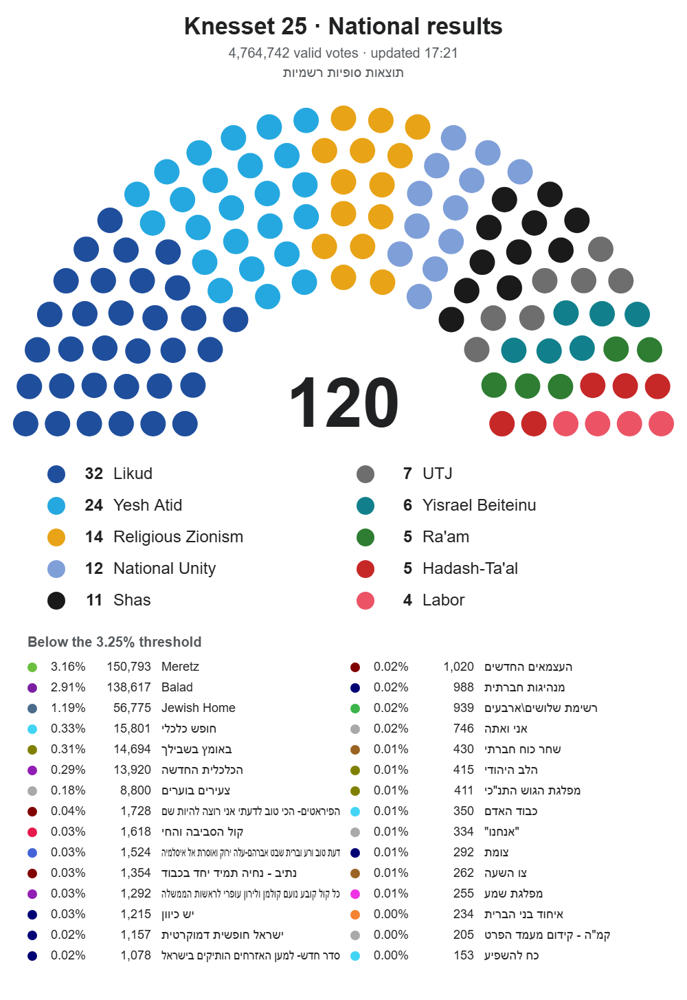

# Knesset Live Results

Follow the Israeli Knesset election count as it happens. A small local web app watches the Central Elections
Committee results site, computes the seat allocation that the site itself doesn't show while votes are being counted,
and turns it into a Wikipedia-style seat diagram plus text you can paste straight into Discord.


## Features

- **Seats from the live count.** The 3.25% threshold, the Bader-Ofer method and surplus agreements, as set out in
  the Knesset Elections Law. Run on the 2022 results, it reproduces the official 32 / 24 / 14 / 12 / 11 / 7 / 6 / 5 / 5 / 4.
- **National, municipality or polling station.** Pick a municipality, or a single polling station inside one. For
  those, the diagram shows the Knesset *as if the whole country had voted like that place*.
- **Wikipedia-style seat diagram.** Uses the same seat layout as the parliament diagram tool behind Wikipedia's Knesset
  images, with a legend, and every list below the threshold underneath.
- **Every list counts.** Small parties are never lumped into "others": each list appears in the diagram legend, the
  table and the Discord text with its percentage and raw vote count.
- **One-click Discord sharing.** Copy the image and paste it with Ctrl+V, drag it into the chat, or download the PNG.
  Copy the text with one button; if it's longer than Discord's 2,000-character limit it splits into numbered parts.
- **Your own labels.** Rename and recolour lists, reorder them in the diagram, and edit surplus agreements. These are
  saved per election, because the same ballot letters belong to different lists in different elections.
- **Light on the site.** One page load per minute (see [Monitoring](#monitoring)), and every new national result is
  saved as JSON in `snapshots/`.

## Quick start

You need Python 3.9 or later and a modern browser (Chrome or Edge recommended, since copying images to the clipboard
works best there).

```
pip install -r requirements.txt
```

- **Windows:** double-click `start.bat`.
- **Other systems:** run `python app.py`.

Your browser opens at <http://localhost:8026>. Closing the console window stops the app. If it's already running,
starting it again just opens the page.

**Try it before election day:** open **Settings** and set **Knesset #** to `25` to load the final 2022 results.

## Using it

### Choosing what to show

| Control | Shows |
|---|---|
| **National** | Country-wide results |
| **Municipality** box | Type part of a name and pick from the list |
| **Polling station** menu | Becomes active once a municipality is chosen. Lists every ballot box with its location name |

The page updates by itself whenever new results arrive. The status line at the top says when the site was last
checked and when results last changed.

### Sharing to Discord



- **Copy image**, then Ctrl+V in Discord. This is the most reliable way.
- Drag the image from the page into the Discord window.
- **Download PNG** saves the file.
- **Copy text** copies the results as Discord-formatted text: seats in bold, then every list with its % and votes.
  Lists below the threshold get their own section.

### Lists table

- **Name:** type a display name, e.g. English. Leave it blank to use the name from the results site.
- **Colour:** click the swatch.
- **▲ ▼:** move a list left or right in the diagram (top of the table = left side). By default lists are ordered
  by seats.

### Surplus agreements

Each pair is treated as one list when the leftover seats are handed out, but only if both lists pass the threshold.
Add, change or remove pairs here. The seats are recalculated immediately.

### Settings

| Setting | Meaning |
|---|---|
| Knesset # | Which election site to follow: `26` → votes26.bechirot.gov.il, `25` → votes25… |
| Check every (s) | How often the national page is loaded. Minimum 30, default 60 |
| Threshold % | Electoral threshold (3.25) |

## Election-night checklist

1. **Settings → Knesset #** = `26`.
2. **Surplus agreements:** check them against the final list published by the Central Elections Committee (the
   deadline for agreements was 16 October 2026). The app comes with the five that had been reported by then:
   Likud–Religious Zionism, Shas–UTJ, Yashar! (Eisenkot)–Democrats, Together (Bennett)–Yisrael Beiteinu, and
   Ra'am–Joint List.
3. **Names and colours:** the 13 main lists have English names. Smaller lists show their Hebrew name from the site.
   Rename or recolour any of them to taste.
4. Until the site goes live, the status line will show `404 Not Found`. That's expected; the app keeps checking.

## How it works

### Monitoring

The results site can't announce new results: it has no push updates, its ETag changes on every response so
conditional requests never return "not modified", and HEAD requests are redirected. Loading the page is the only way to
see whether anything changed, so the app keeps that to a minimum:

- It loads `nationalresults` once per interval. The default of 60 s matches the site's own `Cache-Control: max-age=60`,
  so checking more often would only get back the same cached page.
- It compares the parsed results with the previous ones, and only re-renders and saves a snapshot when they differ.
- It loads a municipality or polling-station page only when you open it, and loads it again only after the national
  results have changed.
- It sends a browser User-Agent, because the site's firewall serves an error page to scripts.

Pages used: `nationalresults`, `cityresults?cityID=…` and `ballotresults?cityID=…&BallotNumber=…` on
`votes{N}.bechirot.gov.il`. The lists of municipalities and polling stations come from the same pages.

### Seat allocation

Implemented in `allocate()` in `app.py`:

1. Lists with less than 3.25% of the valid votes get no seats.
2. The 120 seats are divided among the remaining lists by the Bader-Ofer method, which gives the same result as
   D'Hondt. A surplus-agreement pair counts as a single list, but only if both partners passed the threshold.
3. A pair's seats are then split between its two lists by the same method, so a shared extra seat goes to the partner
   with more votes per seat.

## Configuration

Settings live in `config.json`. The UI edits it for you, but it's plain JSON:

```jsonc
{
  "knesset": 26,           // which votesNN site to follow
  "poll_seconds": 60,
  "seats": 120,
  "threshold": 0.0325,
  "elections": {           // per election, because ballot letters are reused
    "26": {
      "agreements": [["מחל", "ט"], ...],                          // surplus-agreement pairs, by ballot letters
      "order": [],                                                 // diagram order, left to right (optional)
      "parties": {"מחל": {"name": "Likud", "color": "#1f4e9c"}}   // display names and colours
    }
  }
}
```

## Project layout

| File | Role |
|---|---|
| `app.py` | Local web server, monitor loop, page parser, seat allocation |
| `index.html` | The UI: seat diagram drawing, Discord text, editing |
| `config.json` | Settings, names, colours and agreements |
| `start.bat` | Double-click launcher for Windows |
| `test_app.py` | Offline tests |
| `snapshots/` | Each new national result, saved as JSON (created on first change; not in git) |

## Tests

```
python test_app.py
```

These run offline. They check the seat allocation against the official 2022 result, the surplus-agreement edge cases
(a pair where one list misses the threshold, a list in two pairs), and the page parser.

## Limitations

- **Projections, not results.** During the count, seats are based on the votes counted so far. Double-envelope votes
  (soldiers, diplomats, prisoners, hospital patients) are counted last and can still move seats.
- **The page parser was built from the 2022 final-results pages.** If the live 2026 pages are laid out differently, the
  status line will show a parse error, and `parse_results()` in `app.py` will need adjusting.
- **One municipality at a time.** A table of every municipality at once would mean about 1,200 page loads, which is
  more than this tool should put on the site.
- Not affiliated with the Central Elections Committee.
